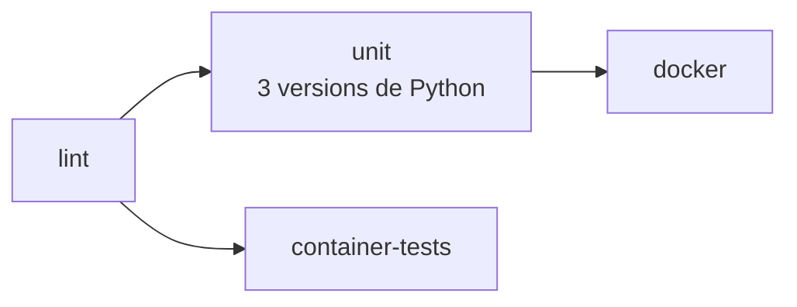

# Atelier 2 — Premier pipeline

`1 h 30` `GitHub Actions` `Matrice` `Seuil bloquant` 

> **Corrigé**
>
>
> Cette page donne le workflow complet. Il se construit en six étapes, chacune ajoutant une notion.

## Le résultat à atteindre



| Job | Rôle | Bloque la fusion |
|---|---|---|
| `lint` | Style et erreurs évidentes, avec annotations dans la PR | oui |
| `unit` | Tests unitaires et d'API sur trois versions, couverture ≥ 85 %, rapports | oui |
| `container-tests` | Les mêmes tests dans une image Docker | oui |
| `docker` | Construction de l'image et test de fumée | oui |

## Construire le pipeline pas à pas

### 1. Le pipeline minimal

```yaml
name: CI
on:
  push:
    branches: [main]
  pull_request:
jobs:
  test:
    runs-on: ubuntu-latest
    steps:
      - uses: actions/checkout@v4
      - uses: actions/setup-python@v5
        with: { python-version: "3.12" }
      - run: pip install -r requirements-dev.txt
      - run: pytest -m "unit or api"
```

Poussé sur votre branche avec une PR ouverte vers `main` **de votre fork**, il apparaît dans l'onglet
*Actions* et dans la PR.

### 2. Le lint d'abord

```yaml
  lint:
    runs-on: ubuntu-latest
    steps:
      - uses: actions/checkout@v4
      - uses: actions/setup-python@v5
        with: { python-version: "3.12" }
      - run: pip install ruff
      - run: ruff check . --output-format=github     # annotations dans la PR
      - run: ruff format --check .

  unit:
    needs: lint
```

`needs: lint` impose l'ordre : inutile de lancer les tests si le style est déjà refusé. Le job
n'installe que `ruff`, pas toutes les dépendances : il répond en quelques secondes.

### 3. Matrice et parallélisme

```yaml
  unit:
    needs: lint
    runs-on: ubuntu-latest
    strategy:
      fail-fast: false
      matrix:
        python: ["3.11", "3.12", "3.13"]
    steps:
      - uses: actions/checkout@v4
      - uses: actions/setup-python@v5
        with:
          python-version: ${{ matrix.python }}
          cache: pip
          cache-dependency-path: requirements-dev.txt
      - run: pip install -r requirements-dev.txt
      - run: pytest -m "unit or api" -n auto
```

- **`fail-fast: false`** : si Python 3.13 échoue, les deux autres versions vont au bout. On sait
  ainsi si le problème est général ou propre à une version.
- **`cache: pip`** : les paquets téléchargés sont réutilisés d'un run à l'autre.
- **`-n auto`** : les tests se répartissent sur tous les cœurs du runner.

### 4. Rapports et seuil bloquant

```yaml
      - name: Tests unitaires + API en parallèle (xdist)
        run: >
          pytest -m "unit or api" -n auto
          --cov --cov-report=xml --cov-report=html --cov-fail-under=85
          --junitxml=reports/junit-${{ matrix.python }}.xml
      - uses: actions/upload-artifact@v4
        if: always()                                   # même si les tests échouent
        with:
          name: test-reports-${{ matrix.python }}
          path: |
            reports/
            htmlcov/
            coverage.xml
      - name: Résumé dans la page du run
        if: always() && matrix.python == '3.12'
        run: |
          echo "### Couverture" >> "$GITHUB_STEP_SUMMARY"
          python -m coverage report --format=markdown >> "$GITHUB_STEP_SUMMARY"
```

- **`--cov-fail-under=85`** fait échouer le job sous 85 %. Avec les seuls tests de départ, la
  couverture est d'environ 63 % : le job est **rouge tant que l'atelier 1 n'est pas terminé**.
  C'est le comportement voulu.
- **`if: always()`** : sans lui, l'envoi du rapport est sauté précisément quand les tests échouent.
- **Le nom de l'artefact contient la version** : trois jobs de la matrice ne peuvent pas publier sous
  le même nom.
- **Le résumé** n'est écrit que par une ligne de la matrice, pour ne pas l'afficher trois fois.

### 5. Conteneurs

```yaml
  container-tests:
    needs: lint
    runs-on: ubuntu-latest
    container: python:3.12-slim
    steps:
      - uses: actions/checkout@v4
      - run: pip install -r requirements-dev.txt
      - run: pytest -m unit -q

  docker:
    needs: unit
    runs-on: ubuntu-latest
    steps:
      - uses: actions/checkout@v4
      - run: docker build -t minishop:${{ github.sha }} .
      - name: Smoke test du conteneur
        run: |
          docker run -d -p 8000:8000 --name app minishop:${{ github.sha }}
          timeout 30 bash -c 'until curl -sf localhost:8000/health; do sleep 1; done'
          curl -sf localhost:8000/products | grep -q mug
```

- **`container:`** exécute toutes les étapes dans l'image indiquée : pas besoin de `setup-python`.
- **Le test de fumée** attend que l'application réponde, avec une limite de 30 secondes, puis vérifie
  qu'une route métier renvoie bien un produit. Un `sleep 5` serait soit trop long, soit trop court.
- **L'image est étiquetée par l'identifiant du commit** : on sait toujours quel code elle contient.

### 6. Protéger `main`

*Settings → Branches → Add branch protection rule* sur `main` :

- [x] *Require a pull request before merging*
- [x] *Require status checks to pass before merging*, avec les vérifications `lint` et `unit`
- [x] *Require branches to be up to date before merging*

Les vérifications n'apparaissent dans la liste qu'après avoir tourné au moins une fois.

## Le workflow complet

```yaml title=".github/workflows/ci.yml"
# SOLUTION Atelier 2 — Pipeline CI de base
name: CI

on:
  push:
    branches: [main]
  pull_request:
  workflow_dispatch:

concurrency:                      # annule le run précédent de la même branche
  group: ci-${{ github.ref }}
  cancel-in-progress: true

permissions:
  contents: read

jobs:
  lint:
    runs-on: ubuntu-latest
    steps:
      - uses: actions/checkout@v4
      - uses: actions/setup-python@v5
        with: { python-version: "3.12" }
      - run: pip install ruff
      - run: ruff check . --output-format=github     # annotations dans la PR
      - run: ruff format --check .

  unit:
    needs: lint
    runs-on: ubuntu-latest
    strategy:
      fail-fast: false
      matrix:
        python: ["3.11", "3.12", "3.13"]
    steps:
      - uses: actions/checkout@v4
      - uses: actions/setup-python@v5
        with:
          python-version: ${{ matrix.python }}
          cache: pip
          cache-dependency-path: requirements-dev.txt
      - run: pip install -r requirements-dev.txt
      - name: Tests unitaires + API en parallèle (xdist)
        run: >
          pytest -m "unit or api" -n auto
          --cov --cov-report=xml --cov-report=html --cov-fail-under=85
          --junitxml=reports/junit-${{ matrix.python }}.xml
      - uses: actions/upload-artifact@v4
        if: always()                                   # même si les tests échouent
        with:
          name: test-reports-${{ matrix.python }}
          path: |
            reports/
            htmlcov/
            coverage.xml
      - name: Résumé dans la page du run
        if: always() && matrix.python == '3.12'
        run: |
          echo "### Couverture" >> "$GITHUB_STEP_SUMMARY"
          python -m coverage report --format=markdown >> "$GITHUB_STEP_SUMMARY"

  # Exécution DANS un conteneur : même image partout, indépendante du runner
  container-tests:
    needs: lint
    runs-on: ubuntu-latest
    container: python:3.12-slim
    steps:
      - uses: actions/checkout@v4
      - run: pip install -r requirements-dev.txt
      - run: pytest -m unit -q

  docker:
    needs: unit
    runs-on: ubuntu-latest
    steps:
      - uses: actions/checkout@v4
      - run: docker build -t minishop:${{ github.sha }} .
      - name: Smoke test du conteneur
        run: |
          docker run -d -p 8000:8000 --name app minishop:${{ github.sha }}
          timeout 30 bash -c 'until curl -sf localhost:8000/health; do sleep 1; done'
          curl -sf localhost:8000/products | grep -q mug
```

Deux ajouts du corrigé que l'énoncé ne demandait pas :

`concurrency`
:   Annule le run précédent de la même branche quand un nouveau commit arrive. Inutile de terminer un
    pipeline dont le résultat est déjà périmé.

`permissions: contents: read`
:   Le jeton du workflow ne reçoit que le droit de lire le code. C'est le principe du moindre privilège.

## Vérifier que le pipeline joue son rôle

| Expérience | Résultat attendu |
|---|---|
| Casser le style (une ligne trop longue, un import inutile) | `lint` rouge, tests non lancés |
| Casser un test | Job de tests rouge sur toutes les lignes de la matrice, rapports tout de même téléchargeables |
| Supprimer des tests | Job de tests rouge sur le seuil de couverture |
| Tenter de fusionner avec un job rouge | Bouton de fusion bloqué par la protection de branche |

## L'équivalent GitLab CI

Les notions sont les mêmes, le vocabulaire diffère. L'extrait est donné pour l'application Python.

```yaml title=".gitlab-ci.yml"
stages: [lint, test, build]

default:
  image: python:3.12-slim
  cache:
    key: { files: [requirements-dev.txt] }
    paths: [.cache/pip]

variables:
  PIP_CACHE_DIR: "$CI_PROJECT_DIR/.cache/pip"

lint:
  stage: lint
  script:
    - pip install ruff
    - ruff check .
    - ruff format --check .

unit:
  stage: test
  parallel:
    matrix:
      - PYTHON: ["3.11", "3.12", "3.13"]
  image: python:$PYTHON-slim
  script:
    - pip install -r requirements-dev.txt
    - pytest -m "unit or api" -n auto --cov --cov-report=xml --cov-fail-under=85 --junitxml=reports/junit.xml
  coverage: '/TOTAL.*\s+(\d+%)$/'
  artifacts:
    when: always
    reports:
      junit: reports/junit.xml
      coverage_report: { coverage_format: cobertura, path: coverage.xml }
```

| GitHub Actions | GitLab CI |
|---|---|
| `needs:` entre jobs | `stages:` ordonnés |
| `strategy.matrix` | `parallel: matrix` |
| `if: always()` sur l'artefact | `artifacts: when: always` |
| `actions/upload-artifact` | `artifacts: reports: junit` (affiché dans la Merge Request) |
| `$GITHUB_STEP_SUMMARY` | mot-clé `coverage:` (pourcentage affiché dans la Merge Request) |

> **Extrait non exécuté**
>
>
> Cet extrait GitLab illustre la correspondance des notions. Il n'a pas été exécuté sur une
> instance GitLab dans le cadre de ce guide.

## Les pièges rencontrés pendant l'atelier

| Symptôme | Cause |
|---|---|
| Le workflow n'apparaît pas | Fichier hors de `.github/workflows/`, ou Actions non activées sur le fork |
| `mapping values are not allowed` | Indentation, ou valeur contenant `: ` non mise entre guillemets |
| Tous les jobs démarrent ensemble | `needs:` oublié |
| Pas de rapport après un échec | `if: always()` oublié |
| Job de tests rouge alors que les tests passent | Seuil de couverture non atteint : lire la dernière ligne du journal |
| La PR part vers le dépôt du formateur | Changer la branche cible : `main` **de votre fork** |

Et selon le langage :

| Symptôme | Cause |
|---|---|
| `ruff format --check` échoue alors que `ruff check` passe | Fichiers non formatés : lancer `ruff format .` en local et commiter |
| `ModuleNotFoundError` dans un job | `pip install -r requirements-dev.txt` absent de ce job : chaque job repart d'une machine vierge |
| L'envoi de l'artefact est refusé pour un nom déjà utilisé | Nom d'artefact sans la version de la matrice |

---

## Fichiers de cet atelier

Par rapport à la branche `python/atelier-01` :

| | Fichier |
|---|---|
| ajouté | `.github/workflows/ci.yml` |

### `.github/workflows/ci.yml`

````yaml
# SOLUTION Atelier 2 — Pipeline CI de base
name: CI

on:
  push:
    branches: [main]
  pull_request:
  workflow_dispatch:

concurrency:                      # annule le run précédent de la même branche
  group: ci-${{ github.ref }}
  cancel-in-progress: true

permissions:
  contents: read

jobs:
  lint:
    runs-on: ubuntu-latest
    steps:
      - uses: actions/checkout@v4
      - uses: actions/setup-python@v5
        with: { python-version: "3.12" }
      - run: pip install ruff
      - run: ruff check . --output-format=github     # annotations dans la PR
      - run: ruff format --check .

  unit:
    needs: lint
    runs-on: ubuntu-latest
    strategy:
      fail-fast: false
      matrix:
        python: ["3.11", "3.12", "3.13"]
    steps:
      - uses: actions/checkout@v4
      - uses: actions/setup-python@v5
        with:
          python-version: ${{ matrix.python }}
          cache: pip
          cache-dependency-path: requirements-dev.txt
      - run: pip install -r requirements-dev.txt
      - name: Tests unitaires + API en parallèle (xdist)
        run: >
          pytest -m "unit or api" -n auto
          --cov --cov-report=xml --cov-report=html --cov-fail-under=85
          --junitxml=reports/junit-${{ matrix.python }}.xml
      - uses: actions/upload-artifact@v4
        if: always()                                   # même si les tests échouent
        with:
          name: test-reports-${{ matrix.python }}
          path: |
            reports/
            htmlcov/
            coverage.xml
      - name: Résumé dans la page du run
        if: always() && matrix.python == '3.12'
        run: |
          echo "### Couverture" >> "$GITHUB_STEP_SUMMARY"
          python -m coverage report --format=markdown >> "$GITHUB_STEP_SUMMARY"

  # Exécution DANS un conteneur : même image partout, indépendante du runner
  container-tests:
    needs: lint
    runs-on: ubuntu-latest
    container: python:3.12-slim
    steps:
      - uses: actions/checkout@v4
      - run: pip install -r requirements-dev.txt
      - run: pytest -m unit -q

  docker:
    needs: unit
    runs-on: ubuntu-latest
    steps:
      - uses: actions/checkout@v4
      - run: docker build -t minishop:${{ github.sha }} .
      - name: Smoke test du conteneur
        run: |
          docker run -d -p 8000:8000 --name app minishop:${{ github.sha }}
          timeout 30 bash -c 'until curl -sf localhost:8000/health; do sleep 1; done'
          curl -sf localhost:8000/products | grep -q mug
````
